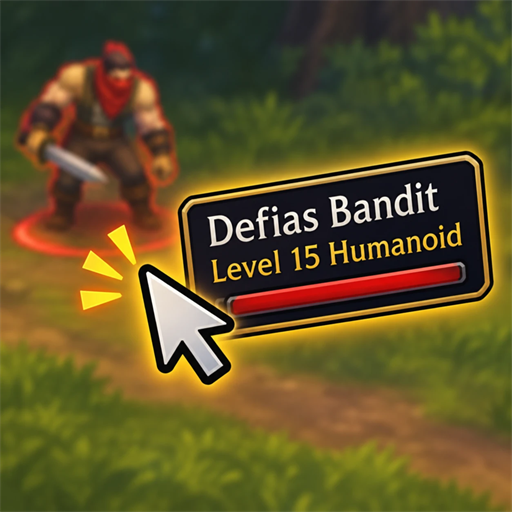

<p align="center">
  
</p>

# Tooltip On Mouse

Show tooltips next to your mouse instead of in the corner of the screen in **World of Warcraft: Forever**.

Hover over a mob, a corpse or a button and the tooltip appears beside your cursor, follows it, and disappears as soon as you move away. Type `/tom` to choose which side it appears on.

## Features

- **Tooltip at your mouse:** works for units and objects in the world, and for anything else that normally uses the corner of the screen.
- **Your choice of side:** left, top, right or down.
- **No lingering:** the tooltip disappears right away when the mouse leaves its target, instead of fading for a few seconds.
- **Combat option:** tooltips can go back to their normal position during combat, so they stay out of the way.
- **Easy to remove:** the addon doesn't change any game options, so uninstalling it leaves your game as it was.

## Installation

1. Close the game, or log out to the character select screen.
2. Copy the `TooltipOnMouse` folder into your AddOns folder:

   ```text
   World of Warcraft\_forever_\Interface\AddOns\TooltipOnMouse
   ```

3. Start the game and make sure **Tooltip On Mouse** is ticked in the AddOns list on the character select screen.

> [!IMPORTANT]
> The folder must be named exactly `TooltipOnMouse`, and `TooltipOnMouse.toc` must be directly inside it. If you unzip a download and end up with a folder inside a folder, move the inner one to `AddOns`.

## Usage

Type `/tom` to open or close the menu (`/tooltiponmouse` also works). You can drag the window, and <kbd>Esc</kbd> closes it. Changes apply straight away and are saved between sessions.

| Option | What it does | Default |
| --- | --- | --- |
| **Tooltip position** | Puts the tooltip to the left of, above, to the right of, or below the mouse. | Top |
| **Normal position in combat** | During combat, new tooltips use the normal position and fade out as usual. | On |

## Limitations

- **Only tooltips that use the default position move.** Tooltips that the game attaches to a specific button or frame stay where they are.
- **Screen edges still apply.** Near the edge of the screen the tooltip stops at the edge, so it can end up partly under your cursor.
- **Combat only affects new tooltips.** A tooltip already showing when combat starts stays at your mouse until it closes.

## Troubleshooting

| Problem | What to try |
| --- | --- |
| `/tom` does nothing | Check the addon is ticked in the AddOns list and the folder layout matches [Installation](#installation). |
| The tooltip stays in the corner | You may be in combat with **Normal position in combat** on. Untick it in the menu to keep tooltips at your mouse. |
| An update doesn't seem to apply | Type `/reload`. A first install needs a full game restart. |
